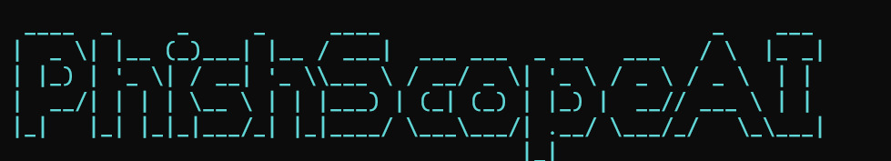

<p align="center">
  
</p>

# 🛡️ PhishScope v3.0 — Console CLI d'Analyse Anti-Phishing, OSINT & Threat Intel

[](https://python.org)
[](https://github.com/CalderaFourier-code)
[](https://github.com/CalderaFourier-code)
[](https://github.com/CalderaFourier-code)
[](LICENSE)
[](https://github.com/CalderaFourier-code)

**PhishScope v3.0 (SOC Enterprise Edition)** est un moteur d'investigation forensique et de Threat Intelligence 100% en ligne de commande (CLI). Conçu pour les analystes SOC, CERT et les chercheurs en cybersécurité, il dissèque en temps réel les URLs suspectes grâce à une double approche : **analyse heuristique avancée (homographes, leet-squatting, entropie)** et **sondes actives OSINT réseau (résolution DNS, interrogations RDAP de l'âge de domaine, inspection TLS et démasquage automatique des réducteurs d'URL)**.

Conçu sous forme d'**application autonome ultra-portable sans aucune dépendance pip obligatoire** (utilise la bibliothèque standard Python), il s'exécute immédiatement sur n'importe quel système (Linux, Windows, macOS, Kali Linux).

---

## 🌟 Quoi de neuf en Version 3.0 (Enterprise SOC Edition) ?

Contrairement aux analyseurs statiques basiques qui génèrent des faux positifs ou ratent les attaques complexes :
1. ✅ **Zéro Faux Positif sur les Portails Officiels Certifiés (0/100) :**
   - Une whitelist certifiée de domaines d'infrastructure officielle (`accounts.google.com`, `login.microsoftonline.com`, `paypal.com`, `appleid.apple.com`, etc.) garantit qu'un portail légitime avec mot-clé `login` n'est jamais faussement étiqueté comme phishing.
2. 🎯 **Détection Avancée du Leet-Squatting dans les Domaines Composés :**
   - Normalisation Leetspeak (`0->o`, `1->l`, `3->e`, `5->s`, `8->b`, `vv->w`, `rn->m`) et découpage par tokens (`paypa1-update-security.top` -> alerte critique immédiate sur `paypa1` imitant `paypal`).
3. 🕵️‍♂️ **Démasquage Automatique des Liens Raccourcis (Shortener Unmasking) :**
   - Trace récursivement les redirections HTTP (301, 302) des réducteurs d'URL (`bit.ly`, `tinyurl.com`, `t.co`, `cutt.ly`, etc.) et analyse automatiquement la page d'atterrissage finale cachée.
4. 🌐 **Sondes Réseau Actives (Active Network OSINT) :**
   - **Résolution DNS directe & Détection SSRF :** Résolution d'IPs et détection des adresses locales/privées (192.168.x.x, 10.x.x.x, 127.0.0.1).
   - **Interrogation RDAP (Âge et Enregistreur) :** Calcul en direct de l'âge du domaine via protocole RDAP. Détection des **domaines jetables nouvellement enregistrés (< 30 jours)** utilisés massivement par les campagnes de spear-phishing.
   - **Inspection des Certificats TLS/SSL :** Extraction de l'autorité de certification (CA) et identification des certificats gratuits automatisés (Let's Encrypt / cPanel) sur des cibles financières sensibles.
5. 🛡️ **Intégration Optionnelle VirusTotal v3 :**
   - Si la variable d'environnement `VT_API_KEY` est configurée, PhishScope interroge en direct le ratio de détection mondial des moteurs antivirus.

---

## 🔬 Moteurs de Détection Intégrés

1. 🔤 **Moteur Anti-Homographes (IDN Spoofing & Confusables) :**
   - Détection des caractères Cyrilliques ou Grecs visuellement identiques aux lettres latines (ex: `аpple.com` avec un `а` cyrillique U+0430 au lieu de `a` latin).
   - Analyse et décodage automatique du préfixe Punycode (`xn--...`).
2. 🎯 **Moteur de Typosquatting & Combosquatting :**
   - Calcul de la **distance de Levenshtein** et normalisation Leetspeak contre les marques à haute valeur cible (Google, Microsoft, Apple, PayPal, Netflix, Amazon, Binance, WhatsApp, MTN, Moov, Orange, Ecobank, etc.).
   - Détection d'injection de marques dans les sous-domaines (`paypal.com.account-update.xyz`).
3. 🧬 **Heuristiques & Entropie de Shannon :**
   - Détection des domaines générés aléatoirement (DGA).
   - Détection des adresses IP numériques directes (`http://192.168.1.1/login`).
   - Surveillance des TLDs à forte teneur d'abus (`.top`, `.xyz`, `.click`, `.buzz`, `.tk`, etc.).
   - Détection de l'obfuscation par syntaxe d'authentification (`http://legit.com@phishingsite.com`).
4. 🤖 **Calculateur de Risque & Recommandations SOC :**
   - Jauge graphique en caractères ASCII : **FAIBLE (LÉGITIME)** (0-24), **SUSPECT** (25-49), **ÉLEVÉ** (50-79), **CRITIQUE** (80-100).
   - Recommandations tactiques pour les analystes SOC (sinkholing DNS, corrélation SIEM/Wazuh, révocation de sessions).

---

## 🚀 Utilisation en Ligne de Commande

### 1. Démarrer la Console Interactive (Mode Shell Dédié)
```bash
python phishscope.py
```
Commandes internes disponibles dans le prompt `phishscope@fourier>` :
- Entrez simplement une URL pour l'analyser : `https://paypa1-update-security.top/login.php`
- `bulk urls_sample.txt` : analyse en lot d'un fichier d'URLs
- `history` : afficher l'historique des analyses de la session
- `export session_audit.json` : exporter les résultats au format JSON
- `clear` : nettoyer l'écran
- `exit` : quitter la console

### 2. Scanner une URL en commande directe (One-Shot)
```bash
python phishscope.py -u "https://paypa1-update-security.top/login.php"
```

### 3. Scanner une liste d'URLs en lot (Bulk Triage)
Idéal pour trier un dump d'alertes ou d'emails suspects :
```bash
python phishscope.py -f urls_sample.txt
```

### 4. Sortie JSON brute (pour pipelines & intégration SIEM / Wazuh)
```bash
python phishscope.py -u "http://аpple.com" --json
```

### 5. Lancer le banc d'essai comparatif (Demo)
```bash
python phishscope.py --demo
```

---

## 📸 Exemples de Rapports Forensiques dans le Terminal

### Cas 1 : Portail Officiel Authentique (Google Login) — Score : 0/100 (Légitime)
```text
┌────────────────────────────────────────────────────────────────────────────────────────────┐
│ RAPPORT D'ANALYSE FORENSIQUE PHISHSCOPE v3.0                                               │
├────────────────────────────────────────────────────────────────────────────────────────────┤
│  Cible inspectée : https://accounts.google.com/signin/v2/identifier
│  Domaine FQDN    : accounts.google.com (Racine : google.com)
│  Horodatage      : 2026-11-09T13:41:20
│  Niveau Risque   : [░░░░░░░░░░░░░░░░░░░░░░░░░] 0/100 — FAIBLE (LÉGITIME)
├────────────────────────────────────────────────────────────────────────────────────────────┤
│ TÉLÉMÉTRIE & OSINT RÉSEAU :
│  • Adresse IP Résolue : 172.253.143.84
│  • Âge du Domaine (RDAP) : 10647 jours (Enregistré le 1997-09-15)
│  • Bureau d'enregistrement : MarkMonitor Inc.
│  • Émetteur Certificat TLS : Google Trust Services
├────────────────────────────────────────────────────────────────────────────────────────────┤
│ SYNTHÈSE DE L'INTELLIGENCE :
│   Le domaine racine 'google.com' est un domaine officiel certifié appartenant à GOOGLE. 
│   Même en présence de mots-clés d'authentification (login/signin), cette page fait 
│   partie de l'infrastructure légitime et vérifiée de l'éditeur. 
├────────────────────────────────────────────────────────────────────────────────────────────┤
│ ANOMALIES & INDICATEURS IDENTIFIÉS (0) :
│  [✓] Aucun indicateur d'usurpation ou d'anomalie détecté.
├────────────────────────────────────────────────────────────────────────────────────────────┤
│ RECOMMANDATIONS OPÉRATIONNELLES SOC :
│  ⚡ Aucune action de blocage requise.
│  ⚡ L'infrastructure est authentique et conforme aux enregistrements officiels.
└────────────────────────────────────────────────────────────────────────────────────────────┘
```

### Cas 2 : Typosquatting PayPal + TLD Abusif (.top) — Score : 90/100 (Critique)
```text
┌────────────────────────────────────────────────────────────────────────────────────────────┐
│ RAPPORT D'ANALYSE FORENSIQUE PHISHSCOPE v3.0                                               │
├────────────────────────────────────────────────────────────────────────────────────────────┤
│  Cible inspectée : https://paypa1-update-security.top/login.php
│  Domaine FQDN    : paypa1-update-security.top (Racine : paypa1-update-security.top)
│  Niveau Risque   : [██████████████████████░░░] 90/100 — CRITIQUE (HAMEÇONNAGE CONFIRMÉ)
├────────────────────────────────────────────────────────────────────────────────────────────┤
│ INDICATEURS FORENSIQUES IDENTIFIÉS :
│   ▶ [CRITICAL +40pts] Usurpation de la marque 'PAYPAL' (Leet-Squatting / Typosquatting)
│     ↳ Le domaine tente d'imiter paypal. Leet-Squatting détecté : 'paypa1' -> 'paypal'.
│   ▶ [HIGH +20pts] TLD à Fort Ratio d'Abus (.top)
│   ▶ [MEDIUM +10pts] Mots-clés de Capture d'Identifiants (login, security)
├────────────────────────────────────────────────────────────────────────────────────────────┤
│ RECOMMANDATIONS OPÉRATIONNELLES SOC :
│  ⚡ Bloquer immédiatement l'accès à ce domaine sur les résolveurs DNS (Sinkholing).
│  ⚡ Corréler les journaux Proxy/EDR pour isoler les postes internes ayant contacté cette URL.
│  ⚡ Ajouter l'IoC (domaine et IP) aux règles de détection SIEM / Wazuh.
└────────────────────────────────────────────────────────────────────────────────────────────┘
```

---

## 👤 Auteur

**Tohon Fourier**
- Développeur Cybersécurité & Ingénieur SecOps / Analyste SOC
- GitHub : [@CalderaFourier-code](https://github.com/CalderaFourier-code)
- Portfolio : [calderafourier-code.github.io](https://calderafourier-code.github.io)
